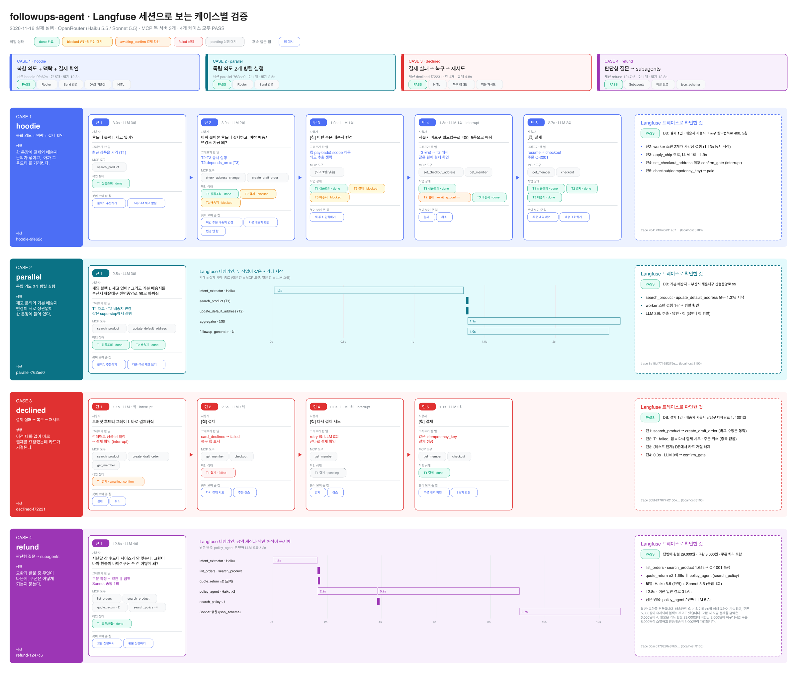
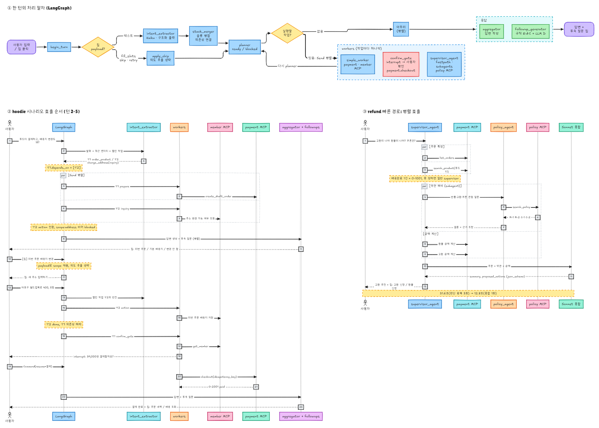

# followups-agent

한 문장에 여러 요청이 섞여도 병렬로 처리하고, 남은 빈칸·확인·다음 단계를 **후속 질문 칩(Follow-ups)**으로 이어 가는 대화 에이전트의 레퍼런스 구현입니다.
LangChain [multi-agent patterns](https://docs.langchain.com/oss/python/langchain/multi-agent#patterns) 중 **Custom workflow + Router**를 바탕으로, 판단형 질문에만 **Subagents**를 씁니다.

- LangGraph (`Send` 병렬 팬아웃, `interrupt` 결제 확인, 체크포인터)
- MCP 목(mock) 서버 3개: payment · member · policy (stdio)
- OpenRouter (Claude Haiku 5.5 / Sonnet 5.5)
- Langfuse v3 로컬 트레이싱 + 트레이스 분석 스크립트

## 관련 자료

| 자료 | 링크 |
|---|---|
| 기획 문서 (패턴 매핑 · 아키텍처 · Follow-ups 분류 · Subagents 적용 지점) | [docs/plan.html](docs/plan.html) · [claude.ai 아티팩트](https://claude.ai/artifact/D8c3CpJowMFdy26DdzXmJZ)¹ |
| 호출 순서 보드 (한 턴의 절차 · hoodie 시퀀스 · refund 빠른 경로) | [Excalidraw](https://app.excalidraw.com/s/71iHvWeZdL/7uXiAzx5oqt)² · [PNG](docs/call-order.png) |
| 케이스별 검증 보드 (Langfuse 실제 세션 기반) | [Excalidraw](https://app.excalidraw.com/s/71iHvWeZdL/6rwNnnI1DRI)² · [PNG](docs/case-verification.png) |

¹ 비공개 아티팩트라 공유받은 사람만 열 수 있습니다. 같은 내용이 `docs/plan.html`에 있습니다.
² Baryon Labs Excalidraw+ 워크스페이스 보드입니다. 접근 권한이 없으면 PNG를 보세요.

## 구조적 멀티턴 확장 (제안요청서 요구사항)

설계: [docs/rfp-structured-multiturn.md](docs/rfp-structured-multiturn.md). 대화 상태를 요약문이 아니라 작업 스택·슬롯·엔티티·칩 payload로 들고 가고, 기능은 플러그인 모듈로 붙입니다.

| 요구 | 모듈 | 핵심 |
|---|---|---|
| 멀티목표 · 의존성 | `state.py` | 카탈로그 `produces/consumes`로 의존성 자동 연결, `refine`(끝난 작업 조건만 바꿔 재실행), 실행 직전 필수 슬롯 재확인 |
| 멀티에이전트 | `graph.py` | `ROUTE_NODES`로 route → worker 배선. 2단계 의도 추출(의도 분리 → 의도별 작은 스키마로 슬롯 병렬 채움) |
| 멀티스키마 Text-to-SQL | `sql_agent.py` · `schema_index.py` · `sql_data.py` · `mcp_servers/datahub.py` | 스키마 인덱스로 출처 선택(모호하면 칩), sqlglot 검증(SELECT만·PII 컬럼 차단·LIMIT), 비용 확인 칩, 읽기 전용 실행 |
| 정책 | `guards.py` | 입력 가드(타인 PII·인젝션·쓰기 SQL 차단 + 대안 칩, 본인 PII 마스킹) · 출력 마스킹 · 판정 기록 |
| 멀티모달 · 보고서 | `attachments.py` | 이미지는 입구에서 한 번만 사실 JSON으로, 보고서는 앞 작업 결과만 근거로 작성 + 근거 없는 수치 표시 |
| 멀티가이드라인 | `state.py` `GUIDELINES` | 작업별로 필요한 지침 id만 부착 (기관 정책 > 업무 > 사용자 선호) |
| 사용자 메모리 | `memory.py` | 턴 종료 후 후보 추출 → 동의 칩 → 출처와 함께 저장, 열람·삭제 |

```bash
uv run python -m followups.web       # 데모 UI http://localhost:8765 (채팅 · 칩 · 이미지 첨부 · 작업 스택 패널)
uv run pytest -q                     # 153개, LLM 없이 (그래프 통합 흐름 포함)
uv run python -m followups.run       # 실제 LLM 시나리오 14개 (src/followups/scenarios/*)
```

LLM 엔드포인트는 환경변수로 바꿉니다. 내부 OpenAI 호환 서버(사내 Solar API, vLLM 등)를 쓰려면 `.env`에 `LLM_BASE_URL`, `LLM_API_KEY`, `MODEL_MAIN`, `MODEL_FAST`를 넣습니다. OpenRouter가 아니면 2단계 추출이 자동으로 켜집니다(`TWO_STAGE_EXTRACT`).

이미지 판독은 두 방식입니다 (`ATTACHMENT_READER`).
- `docparse` (OpenRouter가 아니면 기본값): 같은 서버의 Upstage Document Parse(`DOCPARSE_URL`, 기본 `LLM_BASE_URL` + `/document-parse`)로 OCR. 차트는 표로 복원되고, 텍스트 LLM이 사실 JSON으로 구조화합니다. 이미지 입력을 받지 않는 모델에서도 동작합니다.
- `vlm`: `LLM_VISION_BASE_URL` / `MODEL_VISION`의 이미지 입력 모델에 직접 보냅니다.

복합 발화에서 작은 모델이 첨부 해석 의도를 빠뜨려도, 이번 턴에 들어온 첨부에는 규칙으로 해석 작업을 붙입니다.

내부 Solar(`solar-pro4-1.1.0`) 실측: 시나리오 14개 모두 통과 (2026-11-19, 이미지는 docparse 경로).

## 케이스별 검증



| 케이스 | 무엇을 검증하나 | 결과 |
|---|---|---|
| hoodie (5턴) | 지시어 해석("아까 그 후드티"), 복합 의도, 문의→실행 전환, 슬롯 칩, 의존성 해제, 결제 확인(HITL) | 마포구 주소로 결제 1건 |
| parallel | 독립 의도 2개가 같은 superstep에서 병렬 실행 | 두 도구가 같은 시각에 시작 |
| declined | 결제 실패 → 복구 칩 → 같은 `idempotency_key`로 재시도 | 결제 1건, 중복 없음 |
| refund | supervisor 빠른 경로: 주문 특정 → (약관 subagent ∥ 금액 계산) → Sonnet 종합 1회 | 환불 29,000원 · 교환 3,000원 · 쿠폰 처리, 7.6~8.4초 |

refund 지연은 일반 supervisor 경로 31.6초 → 빠른 경로 12.8초 → policy_agent 출력 축소 후 7.6~8.4초로 줄었습니다. 보드는 12.8초 시점의 세션입니다.

## 호출 순서



```
begin_turn → (칩 payload면 apply_chip | intent_extractor → stack_merger)
          → planner ⇄ workers (Send 병렬: simple_worker / confirm_gate / supervisor_agent)
          → aggregator ∥ followup_generator → 답변 + 후속 질문 칩
```

후속 질문 우선순위는 E 복구 > B 실행 확인 > A 슬롯 채우기 > C 문의→실행 전환 > D 다음 단계입니다. A·B·E는 규칙으로 만들고, 막힌 작업이 있으면 D는 숨깁니다. 칩을 누르면 자연어가 아니라 구조화된 payload로 다시 들어가 의도 추출을 건너뜁니다.

## 실행

```bash
# 0) 설정
cp .env.example .env                 # OPENROUTER_API_KEY 등 채우기 (추론용 키)
cp infra/.env.example infra/.env     # CHANGE_ME 값을 openssl로 생성

# 1) 로컬 Langfuse v3 (http://localhost:3100)
cd infra && docker compose up -d && cd ..

# 2) 규칙 테스트 (LLM 없음)
uv run pytest -q

# 3) E2E 시나리오 (OpenRouter 호출). 결과는 runs/*.json, 트레이스는 Langfuse
uv run python -m followups.run              # hoodie parallel declined refund
uv run python -m followups.run refund       # 하나만

# 4) 트레이스 분석: 턴별 스팬 트리 · 지연 · 토큰 · 병렬 여부 · 오류
uv run python -m followups.inspect_traces
uv run python -m followups.inspect_traces <session-id>
```

## 구조

| 파일 | 역할 |
|---|---|
| `src/followups/state.py` | 상태 스키마, 의도 카탈로그, planner · follow-up · 칩 payload 규칙 (순수 로직, 테스트 대상) |
| `src/followups/graph.py` | 메인 그래프 |
| `src/followups/supervisor.py` | 판단형 의도: 일반 supervisor(subagents as tools) + 교환/환불 빠른 경로 |
| `src/followups/tools.py` | MCP 세션 유지, 서버별 도구 묶음(동적 바인딩) |
| `src/followups/mcp_servers/` | payment · member · policy 목 서버 (`data/*.json` 공유) |
| `src/followups/run.py` | 시나리오 러너 + 최종 상태 검증 |
| `src/followups/inspect_traces.py` | Langfuse API로 트레이스 분석 |
| `infra/docker-compose.yml` | Langfuse v3 (web · worker · Postgres · ClickHouse · Redis · MinIO) |

## 디버깅하며 고친 것 (Langfuse 트레이스로 원인 확인)

- 검색어만 있는 결제 요청이 막힘 → worker가 검색어로 상품 id를 확정
- 다른 상품을 말해도 최근 상품으로 결제될 수 있음 → 검색어가 최근 상품을 가리킬 때만 기억 사용
- `Command(resume)` 후 이전 칩 문구로 답변 → resume과 함께 메시지 갱신
- Sonnet 5.5가 강제 `tool_choice`를 거부(400) → `ToolStrategy` 대신 `ProviderStrategy`(json_schema)
- 한 문장에서 나뉜 하위 질문이 병합 때 덮어써짐 → `merge_slots`로 이어 붙임
- 목 약관 검색이 상위 3개만 돌려줘 쿠폰 조항 누락 → 관련 조항 전부 반환

## 참고

- `.env`가 셸 환경변수보다 우선합니다(`load_dotenv(override=True)`). 셸에 OpenRouter 관리용 키가 있어도 프로젝트 키를 씁니다.
- `max_tokens`를 지정하지 않으면 OpenRouter가 모델 최대치만큼 크레딧을 선확보하려다 402를 냅니다.
- 목 서버의 데이터와 정책은 예시입니다. 실제 서비스 규정이 아닙니다.

## License

MIT
